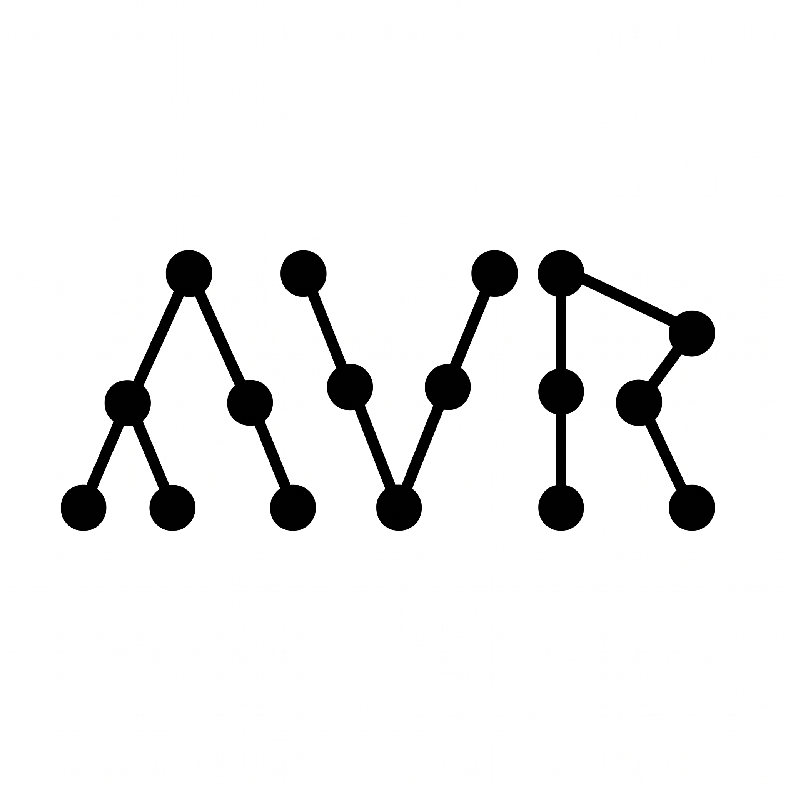

<p align="center">
  
</p>

<h1 align="center">AVORA</h1>
<h3 align="center">Analisador Visual de Operações e Rastreamento de Árvores</h3>

<p align="center">
  <b>Depurador Visual Interativo para Algoritmos e Estruturas de Dados em C11 (Linux / POSIX)</b><br/>
  <i>Motor em Tempo Real com GCC + GDB/MI + AddressSanitizer (ASan) + Raylib 5.x / Raygui 4.x</i>
</p>

<p align="center">
  
  
  
  
</p>

---

## 🎓 Contexto Acadêmico e Motivação

O **AVORA** (*Analisador Visual de Operações e Rastreamento de Árvores*) é um projeto pessoal, de viés acadêmico, desenvolvido por **Filipe de Melo Pereira**, graduando do curso de **Ciência da Computação**.

### Por que o AVORA foi criado?
No estudo de **Algoritmos e Estruturas de Dados** utilizando a linguagem **C**, uma das maiores dificuldades enfrentadas pelos estudantes é a lacuna cognitiva entre o código escrito no editor e o estado real da memória *heap* durante a execução:

1. **Invisibilidade das Mutações de Ponteiros:** Quando um aluno implementa uma rotação dupla em uma Árvore AVL, uma recoloração em uma Árvore Rubro-Negra, uma cisão (*split*) em uma Árvore B/2-3 ou uma remoção com sucessor em-ordem em uma BST, reatribuições como `pai->left = filho->right` acontecem silenciosamente na memória. Um único ponteiro reatribuído na ordem errada pode desconectar uma subárvore inteira ou criar um ciclo infinito.
2. **Erros Silenciosos de Memória em C:** Diferente de linguagens gerenciadas, em C a função `malloc()` não inicializa a memória com zero. Esquecer de atribuir `novo->left = NULL;` ou desreferenciar um ponteiro nulo (`raiz->val` quando `raiz == NULL`) resulta em falhas abruptas (`SIGSEGV` / *Segmentation Fault*) cujas mensagens no terminal raramente são claras para quem está aprendendo.
3. **Prática Estilo LeetCode vs. Depuração Real:** Plataformas como o LeetCode permitem testar algoritmos em árvores (`struct TreeNode`), mas não oferecem uma visualização passo a passo da pilha de recursão, das variáveis locais (`curr`, `pai`, `esq`, `dir`) apontando para os nós e de múltiplas árvores (florestas) lado a lado.

O **AVORA** nasceu para solucionar esse problema: em vez de simular árvores de forma estática, ele **compila o código C real do estudante com `gcc`** e o executa dentro de um processo **GDB via Machine Interface (GDB/MI)** combinado com **AddressSanitizer (ASan)** e um *Harness de Introspecção em Tempo de Execução*. A cada passo (`Step` ou `Auto-Play`), a memória real do programa é inspecionada e renderizada a **60 FPS** com animações suaves, diagnóstico pedagógico em português e o auxílio do mascote interativo **Blob**.

---

## 📥 Como Baixar e Instalar

> **Pré-requisito de Execução:** Como o AVORA compila e depura seu código C em tempo real usando o compilador e o depurador nativos do sistema, certifique-se de ter o **`gcc`** e o **`gdb`** instalados na sua distribuição Linux:
> - **Ubuntu / Debian / Mint / Pop!_OS:** `sudo apt update && sudo apt install gcc gdb`
> - **Fedora:** `sudo dnf install gcc gdb`
> - **Arch Linux / Manjaro:** `sudo pacman -S gcc gdb`

---

### Opção 1: Baixar a Versão Pronta para Uso (Aba *Releases* — Recomendado)

Se você quer apenas baixar e usar o aplicativo imediatamente (sem precisar compilar o código-fonte do AVORA nem instalar bibliotecas gráficas extras):

1. Acesse a aba **[Releases](../../releases)** aqui no GitHub.
2. Baixe o arquivo **`AVORA-v2.0.0-Linux-x86_64-Release.zip`**.
3. Extraia o arquivo `.zip` e escolha como deseja usar:

```bash
unzip AVORA-v2.0.0-Linux-x86_64-Release.zip
cd AVORA-v2.0.0-Linux-x86_64

# Para abrir imediatamente sem instalar no sistema:
./run.sh

# OU para instalar o aplicativo e o ícone no menu de aplicativos do seu Linux:
./install.sh
```

Para remover a instalação do menu de aplicativos a qualquer momento, basta rodar `./uninstall.sh`.

---

### Opção 2: Clonar o Repositório e Compilar do Código-Fonte

Se você deseja explorar o código-fonte, modificar o projeto ou compilar manualmente a partir deste repositório:

#### 1. Instale as dependências de desenvolvimento (`raylib`, `gcc`, `gdb`, `make`)
- **Ubuntu / Debian:**
  ```bash
  sudo apt update && sudo apt install build-essential gcc gdb libraylib-dev
  ```
- **Fedora:**
  ```bash
  sudo dnf install gcc gdb make raylib-devel
  ```
- **Arch Linux:**
  ```bash
  sudo pacman -S base-devel gcc gdb raylib
  ```

#### 2. Clone o repositório e instale (ou execute diretamente)
```bash
git clone https://github.com/SEU_USUARIO/Avora.git
cd Avora

# Compila, gera os ícones a partir da logo.jpg e instala no menu de aplicativos:
./install.sh

# Ou apenas compile e rode localmente no terminal:
make
./aed_tree_debugger
```

---

## ✨ Principais Funcionalidades

### 1. 16 Templates Interativos de Algoritmos, Estruturas de Dados e LeetCode
O seletor superior esquerdo oferece **16 exemplos prontos e comentados** que cobrem desde problemas clássicos do LeetCode (com `main` usando `BUILD_TREE`, vetores `int[]` ou florestas de múltiplas árvores) até estruturas avançadas e armadilhas de ponteiros:

| # | Categoria | Template | Destaque Didático |
| :-: | :--- | :--- | :--- |
| **0** | Scratchpad | **Vazio (Scratchpad Livre)** | Esqueleto limpo para criar sua própria árvore do zero |
| **1** | LeetCode (BST) | **538. Convert BST to Greater Tree** | Travessia em-ordem reversa com `BUILD_TREE` |
| **2** | LeetCode (Vetor) | **108. Vetor Ordenado $\rightarrow$ BST** | `main()` com vetor `int nums[]`, divisão e conquista e `malloc()` |
| **3** | LeetCode (2 Vetores)| **105. Pré & Em-Ordem $\rightarrow$ Árvore** | Reconstrução de árvore a partir de 2 vetores (`preorder` e `inorder`) |
| **4** | LeetCode (Floresta) | **617. Merge Two Binary Trees** | Duas árvores (`t1` e `t2`) lado a lado sendo mescladas em tempo real |
| **5** | LeetCode (Floresta) | **100. Same Tree** | Comparação estrutural simultânea de duas árvores no canvas |
| **6** | LeetCode (Floresta) | **226. Invert Tree + 572. Subtree** | Três árvores na floresta: inversão espelhada e verificação de subárvore |
| **7** | Buscas | **Binária (BST), DFS & BFS** | Comparação prática entre busca em BST, busca em profundidade e largura |
| **8** | BST Clássica | **Inserção & Remoção (3 Casos)** | Remoção de nó folha, nó com 1 filho e nó com 2 filhos (sucessor em-ordem) |
| **9** | Travessias | **Pré-Ordem, Em-Ordem e Pós-Ordem** | Rastreamento visual da pilha de chamadas recursivas |
| **10** | Balanceamento | **Árvore AVL** | Fator de balanceamento e rotações simples/duplas (`LL`, `RR`, `LR`, `RL`) |
| **11** | Balanceamento | **Árvore Rubro-Negra (Red-Black)** | Rotações à esquerda/direita e *flip* de cores |
| **12** | Multi-Chaves | **Árvore B / 2-3 (Cisão / Split)** | Simulação visual de cisão (*split*) e promoção de chave mediana |
| **13** | Armadilha 1 | **Ponteiro Sem `NULL` (Lixo)** | Demonstra o que ocorre ao esquecer `left = right = NULL` após `malloc()` |
| **14** | Armadilha 2 | **Ciclo Estrutural (Rotação)** | Demonstra a detecção imediata de laço fechado (`pai <-> filho`) |
| **15** | Armadilha 3 | **Segfault (Desreferenciar `NULL`)** | Demonstra o acesso inválido `raiz->val` sem verificar `if (raiz == NULL)` |

### 2. API Universal para LeetCode e Geração Inteligente de `main()`
- **`BUILD_TREE("[4, 2, 7, 1, 3, null, 9]")`:** Constrói qualquer árvore binária em nível (*level-order*) com uma única linha de código, idêntico ao formato de entrada do LeetCode.
- **`new_node(int val)` e `bst_insert(root, val)`:** Funções auxiliares já embutidas no ambiente.
- **Modo Sem `main()`:** Se o estudante colar apenas a função de solução do LeetCode (sem escrever `int main()`), o AVORA analisa automaticamente a assinatura da função (`struct TreeNode*`, dois `TreeNode*`, `int* nums, int numsSize`, etc.) e sintetiza uma `main()` invisível alimentada pelo campo **Entrada de Teste** da barra inferior.

### 3. Tratamento Suave de Ponteiros "Em Construção" (`[ ? não inic. ]`)
Em funções que alocam nós manualmente com `malloc(sizeof(struct TreeNode))`, os campos `left` e `right` nascem com lixo de memória (`0xBEBEBEBE...`) até que o código execute as linhas seguintes que atribuem `NULL` ou os filhos recursivos.
- Enquanto a função está executando, o AVORA **não interrompe** a depuração: ele desenha uma linha tracejada suave com o selo `[ ? não inic. ]`, permitindo avançar linha por linha até que os ponteiros sejam inicializados.
- Se o programa tentar **desreferenciar** o ponteiro não inicializado (causando falha) ou se a execução **terminar** com um ponteiro esquecido sem inicialização, o AVORA emite o alerta laranja/vermelho apontando exatamente o endereço e a linha do problema.

### 4. Mascote Pedagógico **Blob**
No canto inferior direito do canvas vive o **Blob**, um assistente interativo animado:
- Ao clicar nos botões `?` da interface ou no próprio Blob, ele abre balões explicativos sobre `BUILD_TREE`, como funcionam os ponteiros em C e dicas de depuração.
- Quando ocorre um erro de compilação ou falha de memória (`SIGSEGV`, ciclo ou lixo), o Blob traduz a mensagem técnica do `gcc`/`gdb` para uma explicação didática em português.
- Quando fica inativo, o Blob encolhe suavemente até virar uma bolinha verde descansando no canto da tela, e fecha o balão automaticamente ao clicar fora dele ou nele mesmo.

---

## 🗂️ Organização do Código-Fonte e Arquitetura

O código-fonte do **AVORA** foi projetado em **C11 puro (`-std=c11 -D_GNU_SOURCE`)** para Linux, sem dependências externas além de `libraylib`, `libm` e `libc`, dividido de forma modular para facilitar a leitura e o estudo:

```text
Avora/
├── include/
│   ├── visualizer.h        # Contrato central de dados, máquinas de estado, structs da árvore,
│   │                       # snapshot de memória, relatórios de diagnóstico e protótipos.
│   └── raygui.h            # Implementação customizada do Raygui 4.x com tema Monochrome
│                           # Matte Black / Grafite / Branco de alto contraste.
├── src/
│   ├── main.c              # Ponto de entrada, inicialização da janela OpenGL/Raylib a 60 FPS
│   │                       # e loop principal não-bloqueante.
│   ├── ipc_gdb.c           # Subsistema IPC/POSIX (fork, pipe, poll não-bloqueante, setpgid,
│   │                       # prctl), gerador do Harness de Introspecção (/tmp/aed_sandbox.c),
│   │                       # parser GDB/MI, detector de raízes de floresta e os 16 templates.
│   ├── layout_renderer.c   # Algoritmo recursivo de posicionamento estético de árvores e
│   │                       # florestas, interpolação suave (Vector2Lerp), setas Bezier,
│   │                       # selos de variáveis locais e animação procedural do mascote Blob.
│   ├── ui_workspace.c      # Editor de código C com fonte monoespaçada real, cálculo exato de
│   │                       # cursor via MeasureTextEx, seleção completa (mouse/teclado),
│   │                       # syntax highlighting, splitters redimensionáveis e barra de controle.
│   └── diagnostics.c       # Tradutor pedagógico de erros do GCC, GDB e AddressSanitizer
│                           # (SIGSEGV, ponteiros não inicializados, ciclos e loops infinitos).
├── logo.jpg                # Arte oficial do AVORA (usada para o ícone da janela e instalador).
├── Makefile                # Script de build padrão em C11 (-Wall -Wextra -O2 -g3).
├── install.sh              # Instalador desktop Linux (compila, redimensiona ícones e cria .desktop).
├── uninstall.sh            # Desinstalador limpo dos arquivos de usuário.
└── README.md               # Documentação principal do projeto.
```

### Detalhes Técnicos da Arquitetura

1. **Harness de Introspecção Injetado ([`src/ipc_gdb.c`](src/ipc_gdb.c)):**
   Consultar dezenas de nós individualmente via comandos GDB/MI causaria latência perceptível na interface. Para manter 60 FPS cravados, o AVORA injeta um prólogo invisível antes do código do aluno (preservando a numeração exata das linhas do editor com `#line 1 "student_code.c"`). Esse prólogo intercepta `malloc`/`free` (envenenando novos blocos com `0xBE` para detectar ponteiros não inicializados e `0xFD` para *use-after-free*), valida ponteiros com `msync(..., MS_ASYNC)` sem causar `SIGSEGV` e serializa toda a floresta de árvores em uma única chamada rápida a cada passo.
2. **Isolamento de Grupo de Processos e Prevenção de Deadlock GDB + ASan ([`src/ipc_gdb.c`](src/ipc_gdb.c)):**
   O subprocesso do GDB é criado com `setpgid(0, 0)` e `prctl(PR_SET_PDEATHSIG, SIGKILL)`, garantindo que nenhum processo órfão sobreviva caso a janela seja fechada ou um loop infinito seja interrompido pelo *Watchdog Timer* de `1.5s` (`kill(-gdb_pid, SIGKILL)`). Além disso, o `LeakSanitizer` é desativado via `ASAN_OPTIONS=detect_leaks=0` para evitar conflito de `ptrace` com o GDB no kernel Linux.
3. **Editor de Código com Medição Exata de Substring ([`src/ui_workspace.c`](src/ui_workspace.c)):**
   O posicionamento do cursor e o *hit-testing* do clique do mouse nunca usam multiplicação aproximada por largura fixa; cada posição é calculada medindo exatamente o prefixo UTF-8 da linha com `MeasureTextEx`, eliminando qualquer desvio visual (*cursor drift*) mesmo em linhas longas ou com caracteres acentuados.

---

## 👨‍💻 Autor

- **Autor:** **Filipe de Melo Pereira**
- **Curso:** Ciência da Computação
- **Instituição:** **Universidade Federal de Pelotas (UFPel)**

---

<p align="center">
  Desenvolvido com dedicação para tornar o estudo de <b>Algoritmos e Estruturas de Dados</b> mais visual, intuitivo e acessível.
</p>
