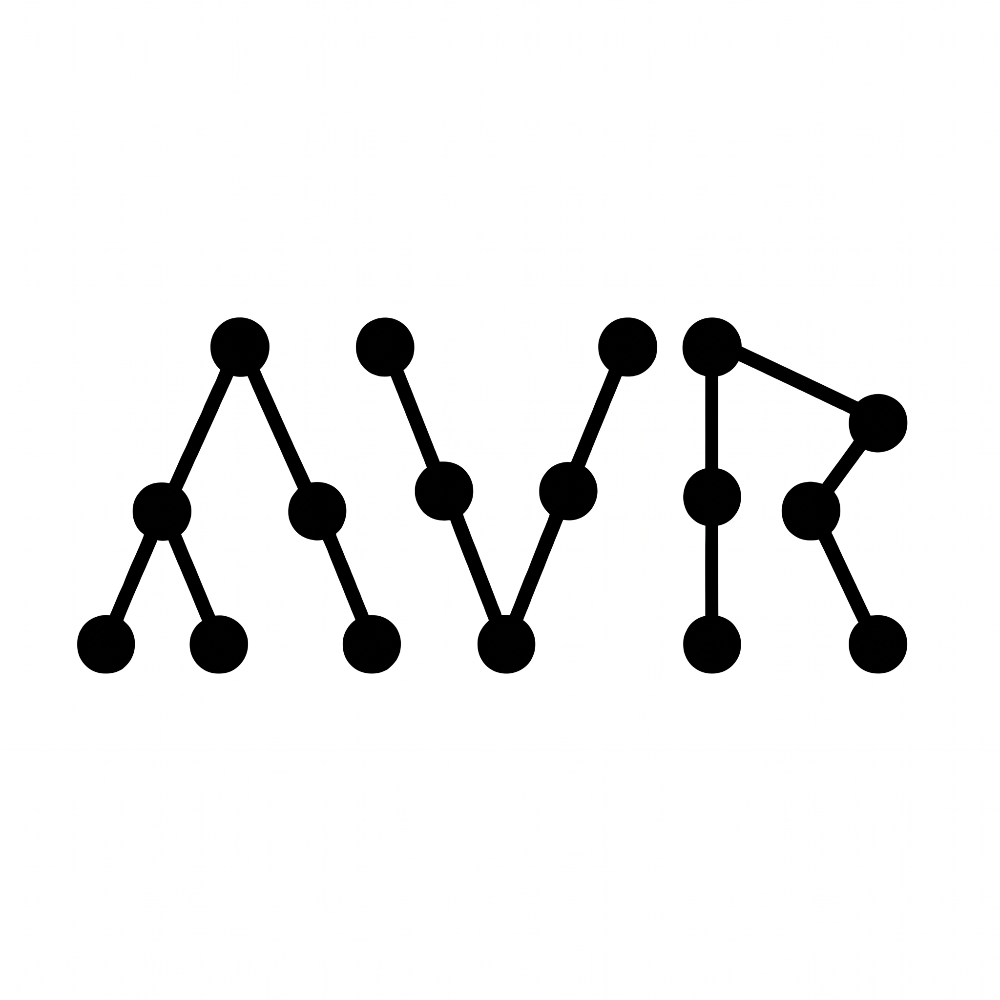

<p align="center">
  
</p>

<h1 align="center">AVORA v3.3.1</h1>
<h3 align="center">Analisador Visual de Operações e Rastreamento de Árvores</h3>

<p align="center">
  <b>Depurador Visual Interativo para Algoritmos e Estruturas de Dados em C11 (Linux / POSIX)</b><br/>
  <i>Motor em Tempo Real com GCC + GDB/MI + AddressSanitizer (ASan) + Raylib 5.x / Raygui 4.x</i>
</p>

<p align="center">
  
  
  
  
  
</p>

---

## 🎓 Contexto Acadêmico e Motivação

O **AVORA** (*Analisador Visual de Operações e Rastreamento de Árvores*) é um projeto pessoal, de viés acadêmico, desenvolvido por **Filipe de Melo Pereira**, graduando do curso de **Ciência da Computação**.

### Por que o AVORA foi criado?
No estudo de **Algoritmos e Estruturas de Dados** utilizando a linguagem **C**, uma das maiores dificuldades enfrentadas pelos estudantes é a lacuna cognitiva entre o código escrito no editor e o estado real da memória *heap* e da pilha de execução (*call stack*):

1. **Invisibilidade das Mutações de Ponteiros:** Quando um aluno implementa uma rotação dupla em uma Árvore AVL, uma recoloração em uma Árvore Rubro-Negra, uma cisão (*split*) em uma Árvore B/2-3, uma inversão de Lista Encadeada ou uma remoção com sucessor em-ordem em uma BST, reatribuições como `pai->left = filho->right` acontecem silenciosamente na memória. Um único ponteiro reatribuído na ordem errada pode desconectar uma subárvore inteira ou criar um ciclo infinito.
2. **Erros Silenciosos de Memória em C:** Diferente de linguagens gerenciadas, em C a função `malloc()` não inicializa a memória com zero. Esquecer de atribuir `novo->left = NULL;` ou desreferenciar um ponteiro nulo (`raiz->val` quando `raiz == NULL`) resulta em falhas abruptas (`SIGSEGV` / *Segmentation Fault*) cujas mensagens no terminal raramente são claras para quem está aprendendo.
3. **Observabilidade de Recursão, Vetores e Código Real:** Plataformas como o LeetCode permitem testar algoritmos em árvores (`struct TreeNode`), listas (`struct ListNode`) e vetores, mas não oferecem uma visualização passo a passo da pilha de chamadas, das variáveis locais escalares/ponteiros mudando a cada instrução e da saída `printf` simultânea.

O **AVORA** nasceu para solucionar esse problema: em vez de simular estruturas de forma estática, ele **compila o código C real do estudante com `gcc`** e o executa dentro de um processo **GDB via Machine Interface (GDB/MI)** combinado com **AddressSanitizer (ASan)** e um *Harness de Introspecção em Tempo de Execução*. A cada passo (`Step` ou `Auto-Play`), a memória real do programa é inspecionada e renderizada a **60 FPS** em uma interface moderna (**Midnight Slate**) com animações suaves, HUD de observabilidade, terminal retrátil e o auxílio do mascote interativo **Blob**.

---

## 📥 Como Baixar e Instalar

> **Pré-requisito de Execução:** Como o AVORA compila e depura seu código C em tempo real usando o compilador e o depurador nativos do sistema, certifique-se de ter o **`gcc`** e o **`gdb`** instalados na sua distribuição Linux:
> - **Ubuntu / Debian / Mint / Pop!_OS:** `sudo apt update && sudo apt install gcc gdb`
> - **Fedora:** `sudo dnf install gcc gdb`
> - **Arch Linux / Manjaro:** `sudo pacman -S gcc gdb`

---

### Opção 1: Baixar a Versão Pronta para Uso (Aba *Releases* — Recomendado)

Se você quer apenas baixar e usar o aplicativo imediatamente (sem precisar compilar o código-fonte do AVORA nem instalar bibliotecas gráficas extras):

1. Acesse a aba **[Releases](https://github.com/ludoista/avora/releases)** aqui no GitHub.
2. Baixe o arquivo **`AVORA-v3.0.1-Linux-x86_64-Release.zip`**.
3. Extraia o arquivo `.zip` e escolha como deseja usar:

```bash
unzip AVORA-v3.0.1-Linux-x86_64-Release.zip
cd AVORA-v3.0.1-Linux-x86_64

# Para abrir imediatamente sem instalar no sistema:
./run.sh

# OU para instalar o aplicativo e o ícone no menu de aplicativos do seu Linux:
./install.sh
```

Para remover a instalação do menu de aplicativos a qualquer momento, basta rodar `./uninstall.sh`.

---

### Opção 2: Clonar o Repositório e Compilar do Código-Fonte

Se você deseja explorar o código-fonte, modificar o projeto ou compilar manualmente a partir deste repositório:

#### 1. Instale as dependências de desenvolvimento (`raylib`, `gcc`, `gdb`, `make`)
- **Ubuntu / Debian:**
  ```bash
  sudo apt update && sudo apt install build-essential gcc gdb libraylib-dev
  ```
- **Fedora:**
  ```bash
  sudo dnf install gcc gdb make raylib-devel
  ```
- **Arch Linux:**
  ```bash
  sudo pacman -S base-devel gcc gdb raylib
  ```

#### 2. Clone o repositório e instale (ou execute diretamente)
```bash
git clone https://github.com/ludoista/avora.git
cd avora

# Compila, gera os ícones a partir da logo.jpg e instala no menu de aplicativos:
./install.sh

# Ou apenas compile e rode localmente no terminal:
make
./aed_tree_debugger
```

---

## ✨ Principais Funcionalidades (v3.3.0)

### 1. Identidade Visual Configurável (7 Temas Estilo Monkeytype), Modo Apresentação / Palco & Áudio Procedural
- **7 Temas em Tempo Real (`Ctrl+,`):** *Midnight Slate*, *Serika Dark*, *Catppuccin Mocha*, *Nord*, *Gruvbox Dark*, *Dracula* e *Serika Light (Paper)* (alto contraste para projetores), aplicados instantaneamente no Editor, Canvas 2D, Nós, `[ ? não inic. ]`, HUD, Terminal e Blob.
- **Modo Apresentação / Palco (`Ctrl+Shift+P`):** Projetado para aulas e apresentações com **controle via setas do teclado ou passadores de slide Bluetooth** (`→`/`PageDown`/`Espaço` para avançar passo, `←`/`PageUp` para voltar no *Time-Travel*, `↑`/`↓` para rolar o código, `[`/`]` para trocar de template), nós e código ampliados e **card concatenado de Diagnóstico + `stdout`** diretamente sobre o Canvas.
- **Fluidez Independente de FPS & Feedback Tátil "Indie Crisp":** Todas as animações usam decaimento exponencial contínuo (`1.0f - expf(-speed * dt)`), 100% interrompível, com resposta tátil nos botões, flash de borda (`~150ms`) em nós modificados e micro-shake em erros.
- **Áudio Procedural em Memória (`src/audio.c`):** Síntese leve de senoides em memória (sem arquivos `.wav` externos) para *Tick* de passo, *Pop* harmônico ao alocar/mutar nós, *Chime* de compilação e *Thud* de erro, 100% *fail-safe* e com botão rápido de **Mudo (`♪ SFX`)** na barra superior.

### 2. Time-Travel Visual (`Shift+F10`), Breakpoints no Gutter (`F9`), HUD & Terminal com `stdin` Opcional
- **Voltar Passo (*Visual Time-Travel*):** Ring buffer em memória com os últimos **128 snapshots** completos (`TreeSnapshot` + linha ativa + Call Stack + variáveis locais), permitindo retroceder e re-avançar a execução instantaneamente sem depender de `reverse-step` do GDB.
- **Breakpoints Clicáveis no Gutter:** Clique no número de qualquer linha no editor para ativar/desativar breakpoints (`●` vermelho) e use `[ ▶ Continuar ]` (`F9`) para saltar diretamente até o ponto de parada.
- **HUD Flutuante (Canto Superior Esquerdo):** Exibe a **Pilha de Chamadas (`-stack-list-frames`)** e todas as **variáveis locais** do frame atual (ponteiros `0x...`/`NULL` e primitivos `int`, `bool`, `char`, `float`), destacando em âmbar (`●`) toda variável alterada no passo.
- **Terminal Retrátil Unificado (`stdout` + `stdin` Opcional):** Captura em tempo real qualquer `printf`/`puts`, com divisão opcional para **Entrada (`stdin`)** e detecção inteligente pelo **Blob** quando `scanf`/`fgets`/`getchar` é utilizado.

### 3. Trilha Sequencial de 24 Templates Embutidos + Templates Personalizados por Pasta
Além do suporte a **pastas dinâmicas de templates** (`~/.config/avora/templates`), o AVORA traz **24 exemplos embutidos** organizados em ordem progressiva de complexidade:

| # | Categoria | Template | Destaque Didático |
| :-: | :--- | :--- | :--- |
| **0** | Scratchpad | **Vazio (Scratchpad Livre)** | Esqueleto limpo para criar sua própria árvore, lista ou algoritmo C |
| **1** | Estruturas Lineares | **Lista Encadeada: Inversão & Ponteiros** | `struct ListNode` + `BUILD_LIST("[10, 20, 30, 40, 50]")` com layout linear |
| **2** | Estruturas Lineares | **Lista Duplamente Encadeada c/ Nó Sentinela** | Inserção ordenada e remoção segura com ponteiros bidirecionais `prev` e `next` |
| **3** | Estruturas Lineares | **Pilha (Stack): Parênteses Balanceados (LIFO)** | `push`/`pop` dinâmico na Heap + vetor de expressão |
| **4** | Estruturas Lineares | **Fila Circular (Queue): Buffer Modular (FIFO)** | `enqueue`/`dequeue` com índices `ini`, `fim`, `qtd` e aritmética `(fim + 1) % cap` |
| **5** | Árvores Binárias | **Travessias Clássicas (Pré, Em e Pós-Ordem)** | Rastreamento visual da pilha de chamadas recursivas |
| **6** | Árvores Binárias | **Buscas: BST, DFS (Profundidade) & BFS** | Comparação prática entre busca em BST, profundidade e largura |
| **7** | Árvores Binárias | **BST Clássica: Inserção & Remoção (3 Casos)** | Remoção de nó folha, 1 filho e 2 filhos (sucessor em-ordem) |
| **8** | LeetCode (BST) | **538. Convert BST to Greater Tree** | Travessia em-ordem reversa com `BUILD_TREE` |
| **9** | LeetCode (Vetor) | **108. Vetor Ordenado $\rightarrow$ BST Balanceada** | `main()` com vetor `int nums[]`, divisão e conquista e `malloc()` |
| **10** | LeetCode (2 Vetores)| **105. Pré & Em-Ordem $\rightarrow$ Árvore** | Reconstrução de árvore a partir de 2 vetores (`preorder` e `inorder`) |
| **11** | LeetCode (Floresta) | **617. Merge Two Binary Trees** | Duas árvores (`t1` e `t2`) lado a lado sendo mescladas em tempo real |
| **12** | LeetCode (Floresta) | **100. Same Tree — Comparar Floresta** | Comparação estrutural simultânea de duas árvores no canvas |
| **13** | LeetCode (Floresta) | **226. Invert Tree + 572. Subtree** | Três árvores na floresta: inversão espelhada e verificação de subárvore |
| **14** | Balanceamento | **Árvore AVL: Fator de Balanceamento & Rotações** | Rotações simples e duplas (`LL`, `RR`, `LR`, `RL`) |
| **15** | Balanceamento | **Árvore Rubro-Negra: Rotações & Flip de Cores** | Rotações à esquerda/direita e *flip* de cores |
| **16** | Multi-Chaves | **Árvore B / 2-3: Cisão (Split) & Mediana** | Simulação visual de cisão (*split*) e promoção de chave mediana |
| **17** | Ordenação & Busca | **Selection Sort + Busca Binária** | Células de vetor no Canvas com selos de índice (`i`, `j`, `esq`, `meio`, `dir`) |
| **18** | Ordenação Rápida | **QuickSort & Partição de Lomuto** | Rastreamento visual de `pivo`, `i`, `j`, `esq`, `dir` e pilha recursiva |
| **19** | Estruturas Avançadas| **Binary Heap (Max-Heap) & HeapSort** | `siftDown` in-place no vetor + projeção da árvore binária implícita |
| **20** | Estruturas Avançadas| **Tabela Hash: Encadeamento Separado & Colisões**| Tratamento de colisões em listas encadeadas + vetor de estado dos buckets |
| **21** | Armadilha 1 | **Ponteiro Sem `NULL` (Lixo de Memória)** | Demonstra o que ocorre ao esquecer `left = right = NULL` após `malloc()` |
| **22** | Armadilha 2 | **Ciclo Estrutural (Rotação Incorreta)** | Demonstra a detecção imediata de laço fechado (`pai <-> filho`) |
| **23** | Armadilha 3 | **Segfault (Desreferenciar `NULL`)** | Demonstra o acesso inválido `raiz->val` sem verificar `if (raiz == NULL)` |

### 4. Mascote Pedagógico **Blob**, Internacionalização (`PT-BR` / `EN-US` / `ES`) & Diagnóstico do Sistema
- **Árvore de Decisão Interativa do Blob:** Ajuda contextual em modo exploratório, diagnóstico guiado em modo de erro e detecção proativa de leitura de `stdin`.
- **Multi-idioma em Tempo Real (`src/i18n.c`):** Interface disponível em **Português (BR)**, **English (US)** e **Español**.
- **Diagnóstico do Sistema & Suporte (`Menu Ajuda`):** Inspeciona versões do `gcc`, `gdb`, suporte ao `AddressSanitizer` e áudio, copiando um relatório Markdown completo em 1 clique.

### 5. Ergonomia Completa de Aplicativo Desktop
- **Menu Bar Superior & Persistência (`~/.config/avora/config.ini`):** Abrir/Salvar `.c`, arquivos recentes, exportar Canvas como `.png` (`Ctrl+E`), Modo Apresentação/Projetor (`Ctrl+Shift+P`), zoom da fonte (`Ctrl++` / `Ctrl+-`) e restauração automática da sessão e geometria da janela.

---

## 🗂️ Organização do Código-Fonte e Arquitetura

O código-fonte do **AVORA** é escrito em **C11 puro (`-std=c11 -D_GNU_SOURCE`)** para Linux, sem dependências externas além de `libraylib`, `libm` e `libc`:

```text
avora/
├── include/
│   ├── visualizer.h        # Contrato central: máquinas de estado, TreeSnapshot, Time-Travel,
│   │                       # Breakpoints, AppConfig, ThemePalette, i18n, Audio e Blob.
│   └── raygui.h            # Implementação customizada do Raygui 4.x com resposta tátil Indie Crisp
│                           # e suporte a temas dinâmicos.
├── src/
│   ├── main.c              # Ponto de entrada, ícone RGBA da janela, geometria e loop principal.
│   ├── config.c            # Persistência ~/.config/avora/config.ini, 7 temas Monkeytype,
│   │                       # scanner de templates dinâmicos por pasta e diálogos nativos.
│   ├── i18n.c              # Tabelas de localização em tempo real (PT-BR, EN-US, ES).
│   ├── audio.c             # Síntese procedural de efeitos sonoros em memória (Raylib/miniaudio).
│   ├── ipc_gdb.c           # IPC POSIX não-bloqueante (fork/pipe/poll/setpgid/prctl), Harness
│   │                       # injetado (/tmp/aed_sandbox.c), captura de stdout + stdin opcional,
│   │                       # Time-Travel ring buffer (128 snapshots), breakpoints e 24 templates.
│   ├── layout_renderer.c   # Layout de Árvores, Florestas, Listas Encadeadas e Vetores 1D,
│   │                       # física exponencial, HUD de Variáveis & Pilha e árvore do Blob.
│   ├── ui_workspace.c      # Menu Bar, Modais (Configurações, Diagnóstico do Sistema, Atalhos),
│   │                       # Editor C11 com gutter de breakpoints e Terminal Retrátil.
│   └── diagnostics.c       # Tradutor pedagógico de erros GCC, GDB e AddressSanitizer.
├── logo.jpg                # Arte oficial do AVORA (ícone da janela e do instalador Linux).
├── Makefile                # Build padrão C11 (-Wall -Wextra -O2 -g3).
├── install.sh              # Instalador desktop Linux (compila, gera ícones PNG e .desktop).
├── uninstall.sh            # Desinstalador limpo dos arquivos de usuário.
├── CHANGELOG.md            # Histórico de versões (v1.0.0 -> v2.0.0 -> v3.0.0 -> v3.1.0 -> v3.2.0).
├── LICENSE                 # Licença do projeto.
└── README.md               # Documentação principal do projeto.
```

---

## 👨‍💻 Autor

- **Autor:** **Filipe de Melo Pereira**
- **Curso:** Ciência da Computação
- **Instituição:** **Universidade Federal de Pelotas (UFPel)**

---

<p align="center">
  Desenvolvido com dedicação para tornar o estudo de <b>Algoritmos e Estruturas de Dados</b> mais visual, intuitivo e acessível.
</p>
